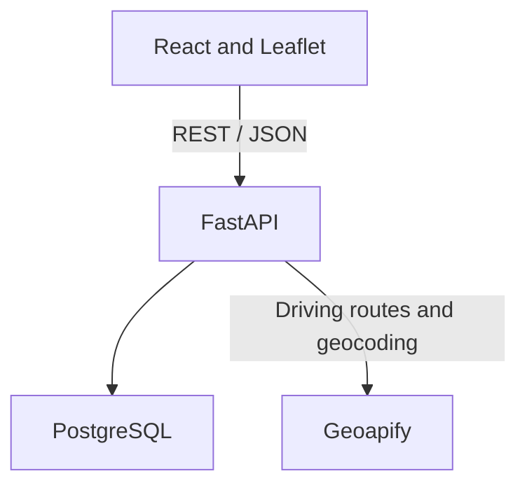

# System Architecture

- **Frontend**: React and Leaflet call `src/services/api.js`. The home page groups
  rooms by building/floor and filters loaded data on Search/Enter. Indoor plans
  use image coordinates, separate from the outdoor geographic map.
- **Backend**: FastAPI with SQLAlchemy models, routes, Pydantic schemas and services.
  Outdoor requests validate the designated entrance and call Geoapify with `drive`.
  Credentials and provider requests remain on the backend.
- **Indoor routing**: `app/utils/dijkstra.py` computes shortest distance over active
  graph connections, respecting stairs/lift preferences and one-way connections.
  It validates weights in the area reachable from the requested start; invalid
  data in a disconnected graph does not disable a valid route elsewhere.
- **Database**: PostgreSQL stores buildings, entrances, floors, room doors and
  graph connections. `outdoor_usage` shares the provider request budget across workers.
- **Paused features**: chat and course schedules retain their code/data, but their
  API routers are disabled. `/schedule` redirects home.

Outdoor driving routes come from Geoapify, not the indoor Dijkstra implementation.
The two stages meet at the designated entrance; there is no automatic arrival
detection, indoor positioning or parking-to-entrance route. Surveyed real data is
required before on-site navigation. A* is not implemented.
